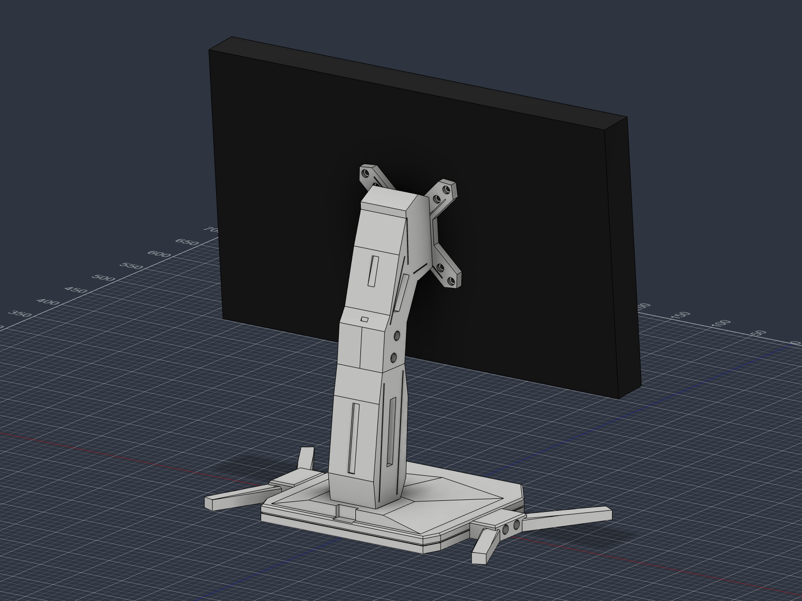
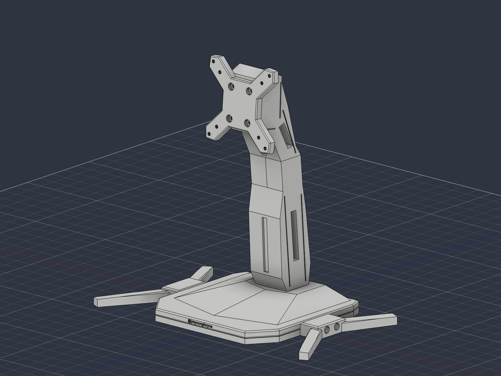
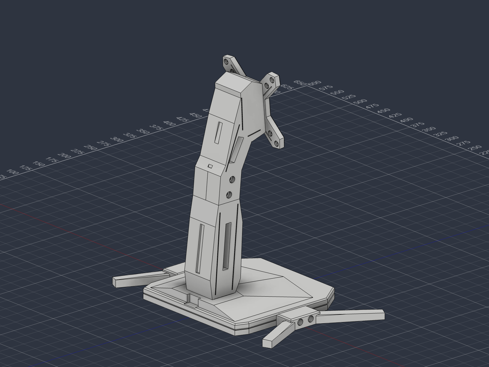

# Cyberpunk Monitor Stand

A fixed, armoured desk stand for the **Samsung Essential S3 22" (LS22C310)**, designed to live in **portrait**
and switch to landscape in about two minutes. Six PLA+ parts, **no supports**, joined with M5 screws into
heat-set inserts, then hand-painted with blue, red and yellow accent lines.

<p align="center">
  
  
</p>

<p align="center">
  
  
</p>

## Build guide

The full guide is **[dist/monitor-stand-build-guide.pdf](dist/monitor-stand-build-guide.pdf)** (12 pages). It covers:

- what to print, with orientation and settings for each part
- the hardware list, and where every heat-set insert and screw goes
- step-by-step assembly
- switching between portrait and landscape
- a painting map: which groove gets which colour
- stability and safety notes

## Quick start

1. Print the six parts in `stl/` in white PLA+. The settings are in the table below, and the ready-made slicer
   projects are in `3d-printing/`.
2. Set the 12 M5 heat-set inserts: 4 in the base sides, 4 in the lower column and 4 in the head.
3. Assemble from the bottom up: feet → base → lower column → upper arm → VESA plate → monitor.
4. Paint the recessed lines, then add the rubber pads.

## Specs

| | |
|---|---|
| Monitor | Samsung LS22C310, 488 × 294 × 41 mm, 2.0 kg |
| Mount | VESA 75 × 75 and 100 × 100 (M4), tilted 5° back |
| Mount height | VESA centre 300 mm above the desk |
| Portrait | Screen from 56 mm to 544 mm above the desk |
| Landscape | Screen from 153 mm to 447 mm above the desk |
| Footprint | 384 × 212 mm with the feet (base alone 216 × 208 mm) |
| Printer | Fits a 220 × 220 mm bed (Ender-3 V3 SE) |

## Parts

| File | Part | Orientation | Walls · infill |
|---|---|---|---|
| `stl/01-base.stl` | Base | Flat on its bottom | 6 · **100%** (min. 60%) |
| `stl/02-foot-left.stl` | Left foot | Flat | 6 · **100%** (min. 60%) |
| `stl/03-foot-right.stl` | Right foot | Flat | 6 · **100%** (min. 60%) |
| `stl/04-lower-column.stl` | Lower column | On its side, half-lap step up | 5 · 40% gyroid |
| `stl/05-upper-arm.stl` | Upper arm + head | On its side, half-lap step up | 5 · 40% gyroid |
| `stl/06-vesa-plate.stl` | VESA plate | Flat, head side down | 5 · 60% |

Print the base and feet dense: they are the counterweight that keeps a portrait monitor from tipping.

## Hardware

| Qty | Item | Use |
|---|---|---|
| 12 | M5 heat-set insert (6.4 mm hole, ≤ 10 mm long) | base, column, head |
| 4 | M5 × 35 | feet to base |
| 2 | M5 × 16 | base to lower column |
| 2 | M5 × 30 | upper arm to lower column |
| 4 | M5 × 12 | VESA plate to head |
| 4 | M4 × 14 | monitor to VESA plate |
| 6 | Rubber bumpers | under the base and feet |

## Repository layout

```
stl/          printable parts, numbered in print order
3d-printing/  slicer projects (.3mf)
cad/          Fusion source archive (monitor-stand.f3d)
images/       renders
docs/latex/   LaTeX source of the build guide
docs/build.sh rebuilds dist/monitor-stand-build-guide.pdf (XeLaTeX + latexmk)
dist/         compiled build guide
```

## Rebuilding the guide

```bash
./docs/build.sh
```

This needs XeLaTeX and latexmk (MacTeX or TeX Live). The fonts are included in `docs/latex/fonts/`.

---

Designed by **Juan Manuel Young Hoyos** · @jmyounghoyos
