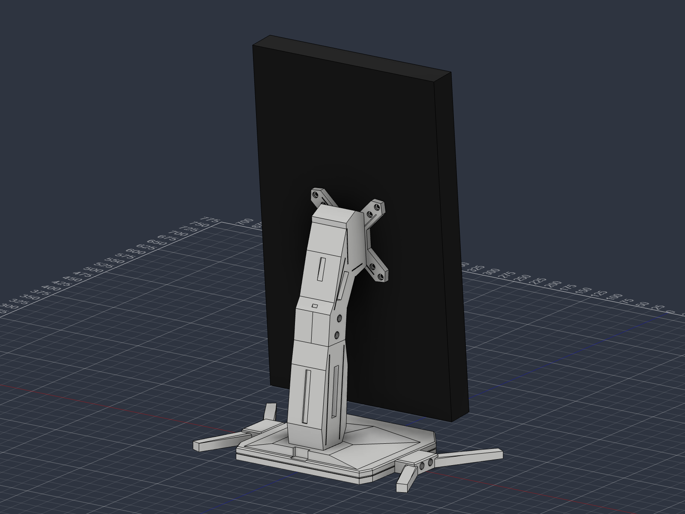

# Cyberpunk Monitor Stand

Fixed, armoured desk stand for the **Samsung Essential S3 22" (LS22C310)**, designed for **portrait** use with a
quick switch to landscape. Six PLA+ parts, no supports, joined with M5 screws into heat-set inserts.



## Build guide

Everything (what to print, hardware, where each insert goes, assembly, switching orientation, painting map and
stability notes) is in **[dist/monitor-stand-build-guide.pdf](dist/monitor-stand-build-guide.pdf)**.

## Parts

| File | Part | Print orientation | Infill |
|---|---|---|---|
| `stl/01-base.stl` | Base | Flat on its bottom | 100% (min. 60%) |
| `stl/02-foot-left.stl` | Left foot | Flat | 100% (min. 60%) |
| `stl/03-foot-right.stl` | Right foot | Flat | 100% (min. 60%) |
| `stl/04-lower-column.stl` | Lower column | On its side, half-lap step up | 40% gyroid, 5 walls |
| `stl/05-upper-arm.stl` | Upper arm + head | On its side, half-lap step up | 40% gyroid, 5 walls |
| `stl/06-vesa-plate.stl` | VESA plate (75 and 100) | Flat, head side down | 60%, 5 walls |

## Hardware

- 12 × M5 heat-set inserts (6.4 mm holes)
- 4 × M5×35 (feet), 2 × M5×16 (column to base), 2 × M5×30 (arm to column), 4 × M5×12 (plate to head)
- 4 × M4×14 (monitor to plate)
- 6 × rubber bumpers

## Repository

```
stl/      printable parts
cad/      Fusion archive (monitor-stand.f3d)
images/   renders
docs/     LaTeX source of the guide + build.sh
dist/     compiled PDF
```

Rebuild the guide with `./docs/build.sh` (XeLaTeX + latexmk).

Designed by Juan Manuel Young Hoyos · @jmyounghoyos
